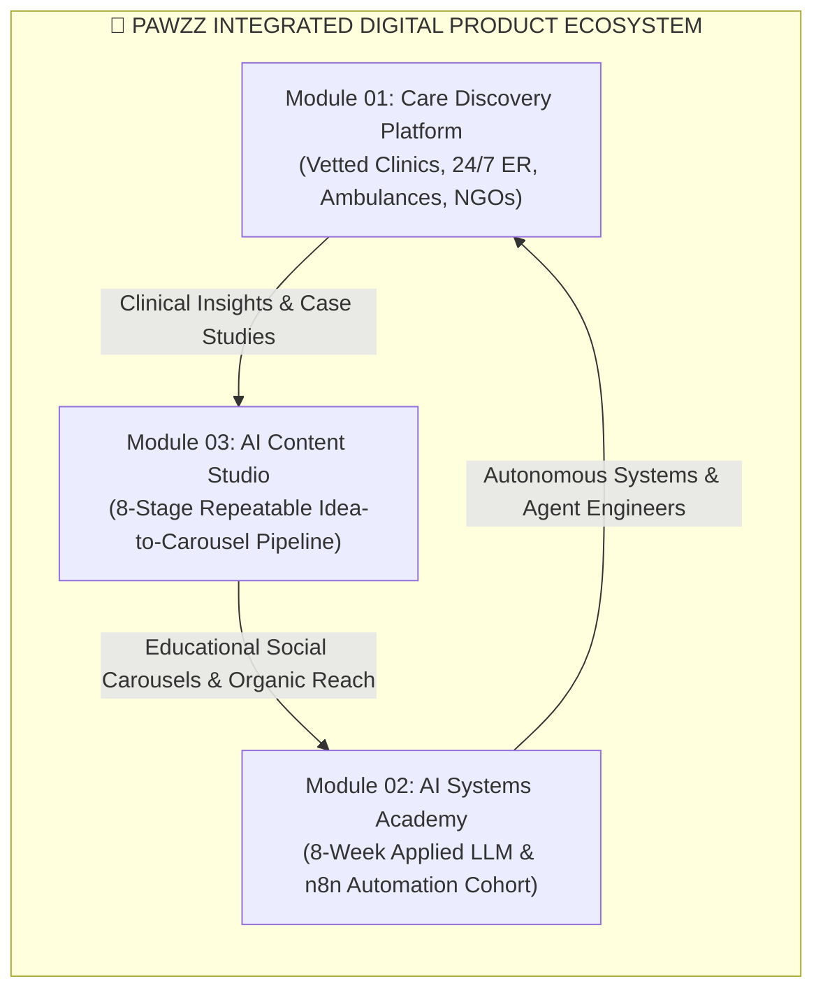
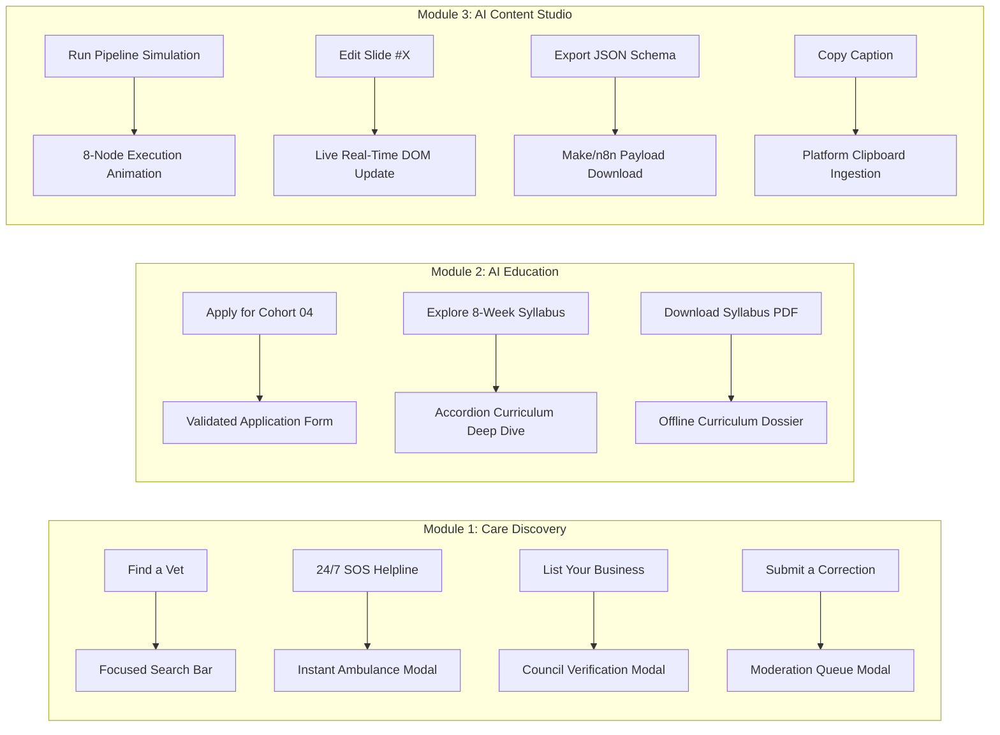
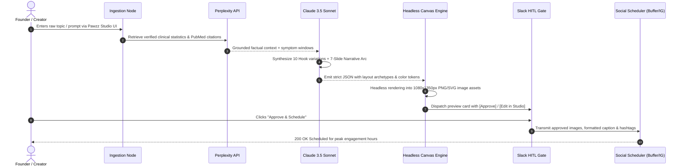

# Pawzz – Integrated Digital Product Ecosystem

> **Assignment Submission**: Product Development, Design & AI Systems Internship Assignment  
> **Role Alignment**: Senior Product Manager, Lead UI/UX Designer & Full-Stack Architect  
> **Live Prototype**: Integrated React 18 + TypeScript + Tailwind CSS application  
> **Repository Directory**: `/Users/khushalagarwal/Desktop/pawzproject`

---

## Table of Contents
1. [Project Overview](#1-project-overview)
2. [Problem Statements](#2-problem-statements)
3. [Target Users & Personas](#3-target-users--personas)
4. [MVP Features Across Modules](#4-mvp-features-across-modules)
5. [Product Decisions & CTA Strategy](#5-product-decisions--cta-strategy)
6. [Technology Stack & System Architecture](#6-technology-stack--system-architecture)
7. [AI Tools, Content Engine & Automation Workflow](#7-ai-tools-content-engine--automation-workflow)
8. [Setup Instructions](#8-setup-instructions)
9. [Demo Scope, Verification & Limitations](#9-demo-scope-verification--limitations)

---

## 1. Project Overview

**Pawzz** is an integrated digital product ecosystem uniting three critical dimensions of modern digital innovation:
1. **Practo for Animals (Care Discovery Platform)**: A high-trust, verified animal healthcare and emergency discovery platform connecting pet parents and animal rescuers to 24/7 trauma hospitals, clinics, oxygen-fitted ambulances, diagnostics, boarding, and NGOs.
2. **AI Education (Pawzz AI Academy)**: A conversion-focused, cohort-based curriculum landing page for students and young professionals seeking hands-on, production-grade Generative AI, autonomous workflow engineering (n8n/Make), and multimodal system design.
3. **AI-Powered Content Creation System (Pawzz Content Studio)**: An interactive 8-stage automated content creation engine that converts raw founder ideas into verified, beautifully formatted, multi-slide social media carousels (Instagram 4:5 & LinkedIn 1:1) with live preview, real-time slide editing, and API-ready JSON export.

### Product Thesis & Strategic Synergy
Rather than treating these three modules as disjointed silos, the Pawzz ecosystem models a modern mission-driven tech company:
- **Module 1** solves a critical real-world problem with immediate social impact (companion & stray animal welfare).
- **Module 2** trains the next generation of builders on practical autonomous systems.
- **Module 3** equips the team and founders with an automated, high-velocity content engine to educate pet parents, share clinical warnings, and drive zero-CAC organic growth.



---

## 2. Problem Statements

### Module 1: Animal Care Discovery
* **The "Golden Hour" Emergency Vacuum**: When a companion animal suffers acute trauma (gastric torsion/bloat, hit-and-run, respiratory distress), pet parents lose crucial minutes searching outdated Google Maps listings with disconnected phone numbers.
* **Unverified Credentials & Hidden Fees**: Pet healthcare suffers from opaque billing, unqualified practitioners, and commercial ranking bias where clinics pay to appear on top.
* **Stray & Rescue Exclusion**: Community street animals and injured strays are typically excluded from private commercial healthcare platforms, leaving rescue volunteers overwhelmed.

### Module 2: AI Education for Builders
* **The "Prompt Engineering" Plateau**: 90% of available online AI courses teach superficial chatbot prompt tricks without addressing production software realities (token economics, KV-cache budgets, structured JSON schema guarantees, and API retry policies).
* **Missing Systems Thinking**: Students lack hands-on experience connecting LLMs to external tools, databases, and event-driven automation platforms like n8n or Make.
* **Unverifiable Portfolios**: Generic certificates are disregarded by tech recruiters; hiring managers demand live GitHub repositories with public URLs and demonstrable system architectures.

### Module 3: Content Creation Bottlenecks
* **High Production Cost & Latency**: Generating high-retention, evidence-backed educational carousels for LinkedIn and Instagram takes 4 to 6 hours per deck across research, copy, visual layout, and graphic export.
* **Fact Hallucination in Pet Healthcare**: Generative AI tools often fabricate symptoms or inaccurate medical advice if not constrained by verified citation retrieval pipelines.
* **Lack of Repeatable Automation**: Content teams juggle disconnected tools (ChatGPT for copy, Canva for manual design, spreadsheets for review) with brittle, manual handoffs.

---

## 3. Target Users & Personas

| Module | Primary Persona | Key Pain Point | Value Delivered by Pawzz |
|---|---|---|---|
| **Module 1: Care Discovery** | **Urban Pet Parents (Dogs/Cats)** | Unsure who to call at 2:00 AM; fear of being overcharged or mistreated. | Instant 24/7 emergency filter, transparent fee ranges, AWBI-verified doctor credentials. |
| **Module 1: Care Discovery** | **Street Animal Rescuers & NGOs** | Managing 100+ daily accident calls across unorganized WhatsApp groups. | Subsidized emergency ambulance dispatch, dedicated NGO category, community correction reporting. |
| **Module 2: AI Education** | **Undergrad & Grad CS/Design Students** | Generic resumes; failing technical AI and PM internship interviews. | Hands-on production capstones (RAG, agent swarms, visual canvas engines) with public code repos. |
| **Module 2: AI Education** | **Young Product Managers & Founders** | Spending 15+ hours weekly on manual data synthesis and content production. | Mastered fluency in n8n, Make, webhooks, and Human-in-the-Loop approval workflows. |
| **Module 3: Content Studio** | **Solopreneurs & Medical Advocates** | Inconsistent publishing cadence; design software fatigue. | 8-step automated pipeline turning a 1-sentence prompt into an editable 7-slide carousel in 90 seconds. |

---

## 4. MVP Features Across Modules

### Module 1: Practo for Animals
* **Value-Oriented Homepage**: Hero section with search console, live 24/7 emergency status indicators, and trust proof points (1,200+ clinics, 0-brokerage community reviews).
* **Comprehensive Search & Dual Filtering**: Search by clinic name, doctor, or medical condition, combined with city selection (Bengaluru, Mumbai, Delhi NCR, Hyderabad, Pune).
* **6 Dedicated Service Categories**:
  1. *Veterinary Clinics*: General health checkups, preventive vaccines, pediatric exams.
  2. *Hospitals*: 24/7 Super-specialty ICU, orthopedics, surgical suites, and trauma care.
  3. *Boarding*: Cage-free pet resorts, feline retreats, and behavioral daycare.
  4. *Diagnostics*: Reference laboratories, digital X-rays, ultrasound, biochemistry panels.
  5. *Ambulances*: Oxygen-fitted mobile intensive care transit and emergency retrieval.
  6. *NGOs & Animal Welfare*: Stray rescue, Animal Birth Control (ABC), adoption, and sanctuary care.
* **Granular Availability Filters**: "Open Now", "24/7 Emergency Active", "Home Visit Available", and "Verified Facilities Only".
* **Rich Provider Cards**: Realistically labeled sample data featuring ratings, review count, distance in km, operating hours, consultation fee estimates, and direct action triggers.
* **Detailed Provider Modal (4 Tabs)**:
  - *Overview & Services*: About the facility, itemized fees, facilities checklist (CT, ICU, Oxygen Cages).
  - *Veterinary Team*: Doctor qualifications, surgical specializations, experience years, and OPD schedules.
  - *Pet Parent Reviews*: Verified reviews detailing pet species treated and ratings.
  - *Location & Hours*: Street address, landmarks, operating hours, and mock interactive map.
* **Core Conversion & Trust CTAs**:
  - *Find a Vet*: One-click scroll and focus into the discovery console.
  - *Explore Services*: Categorized directory navigation.
  - *List Your Business*: Multi-step onboarding modal for clinic managers to submit council registrations.
  - *Submit a Correction*: Crowdsourced data integrity form to report outdated numbers or relocated clinics.
  - *24/7 Pet Ambulance SOS*: Dedicated emergency dispatcher modal with real-time ETA calculation.

### Module 2: AI Education Landing Page
* **Conversion-Optimized Hero**: Compelling headline, trust badges (850+ alumni, 4.9/5 rating), and an interactive terminal showing type-safe agent code.
* **Programme Overview & 4 Pillars**: Explains the shift from naive chat prompting to autonomous workflow engineering.
* **Measurable Learning Outcomes**: 6 competencies tied to tangible metrics (e.g. "100% type-safe pipelines", "<1% hallucination rate").
* **Interactive Curriculum Accordion**: 6 comprehensive modules detailing weekly lecture topics, tools mastered, and hands-on capstone assignments.
* **Target Audience Clarity**: Explicit "Who Is This For" vs "Who Is This NOT For" sections to filter for high-commitment students.
* **Feature Comparison Matrix**: Direct side-by-side analysis contrasting generic online video courses with Pawzz AI Academy.
* **Social Proof**: Verified alumni testimonials from students, associate PMs, and founders.
* **Interactive Registration Form with Validation**:
  - Full Name (length check)
  - Email (regex format validation)
  - Phone (10-digit validation)
  - Current Role (dropdown)
  - AI Experience Level toggle (Beginner, Intermediate, Advanced)
  - Cohort batch preference selection
  - Capstone dream goal (minimum 15 characters)
  - Terms acceptance checkbox
* **Confetti Celebration & Confirmation State**:
  - Fires dynamic `canvas-confetti` upon valid submission.
  - Displays personalized application dossier with unique Reference ID (`PWZ-AI-XXXX`).
  - Outlines the 3-step admissions roadmap (Setup guide, 15-min fit interview, Discord access).
  - One-click `.txt` dossier receipt download.

### Module 3: AI-Powered Content Creation System
* **Interactive 8-Stage Workflow Runner**:
  `Founder Enters Raw Idea` → `AI Research & Structuring` → `Headline Generation` → `Slide-by-Slide Copy` → `Visual Direction` → `Carousel Design` → `Founder Review` → `Editable Export`.
  - Includes a live "Run Pipeline Simulation" button with node-by-node animation and input/output payload inspection.
* **Complete 7-Slide Sample Carousel**:
  - Topic: *"5 Silent Pet Symptoms Most Owners Ignore (Until It's a 2 AM Emergency)"*
  - Slide 1: High-contrast Hook / Title
  - Slide 2: The Hidden Problem & 64% Pain Masking Statistic
  - Slide 3: Two Urgent Alarms (Non-productive retching & pale gums)
  - Slide 4: The 30-Second "P.A.W.S" At-Home Triage Framework
  - Slide 5: The 3 Golden Rules Preventing 80% of Crises
  - Slide 6: Real-World Case Study (Bruno's 6-hour surgical recovery)
  - Slide 7: High-Impact Save & Share CTA
* **Live Studio Controls**:
  - Swipe controls (Previous, Next, dot indicators, and slide number picker).
  - Aspect Ratio Toggle: Instagram Portrait (`4:5`) vs LinkedIn Square (`1:1`).
  - Branded Theme Switcher: *Pawzz Emerald*, *Midnight Indigo*, *Warm Amber*, *Monochrome Slate*.
* **Founder Review & In-Line Slide Editor**: Real-time modal allowing editing of headlines, body copy, bullets, layout archetype, and visual cues.
* **Multi-Format Export**:
  - *Export JSON Schema*: Validated JSON payload ready for n8n/Make webhook ingestion.
  - *Copy Caption & Hashtags*: One-click clipboard copy of engagement-optimized social captions.
  - *Simulate Webhook Push*: Visual confirmation of API dispatch to scheduler.
* **Make / n8n Production Blueprint**: Detailed architecture diagram explaining webhook ingestion, Perplexity research node, Claude JSON copywriting, Satori canvas rendering, Slack HITL approval, and social scheduling.
* **Recommended Tools Analysis**: Evaluation matrix of Claude 3.5 Sonnet, Perplexity API, Recraft, Satori, n8n, and Supabase.
* **Proposed vs Implemented Matrix**: Explicit disclosure of prototype frontend features vs proposed cloud backend services.

---

## 5. Product Decisions & CTA Strategy

### 1. Dual-Audience Navigation & Ecosystem Header
* **Strategic Intent**: Evaluators and users can instantly understand the three modules from the sticky navigation bar, while maintaining clear visual distinction via module badges (`Care Discovery`, `Cohort 04`, `8-Step Engine`).
* **Emergency Top-Bar**: Positioned above the primary nav to give pet parents immediate access to the 24/7 SOS helpline without having to navigate through menus.

### 2. CTA Hierarchy & Conversion Funnels


### 3. Trust Architecture (Zero-Brokerage Guarantee)
* Veterinary discovery platforms often face skepticism due to sponsored listings. Pawzz implements an explicit **Zero Paid Ranking Bias policy**: results are ordered strictly by distance, verified parent ratings, and emergency capability.

---

## 6. Technology Stack & System Architecture

| Layer | Technology | Version | Purpose |
|---|---|---|---|
| **Language** | TypeScript | `~5.6.2` | Strict type safety, clean interfaces, self-documenting schemas. |
| **Framework** | React | `^18.3.1` | Component modularity, reactive state hooks, accessible dialogs. |
| **Build Tool** | Vite | `^6.0.1` | Ultra-fast HMR, ES module bundling, instant build pipeline. |
| **Styling** | Tailwind CSS | `^3.4.16` | Utility-first responsive design, custom color system, glassmorphism. |
| **Icons** | Lucide React | `^1.16.0` | Accessible, unified iconography across medical and tech modules. |
| **Celebration** | Canvas Confetti | `^1.9.4` | Micro-interaction celebration upon cohort form submission. |
| **Typography** | Plus Jakarta Sans & Space Grotesk | Google Fonts | Modern SaaS typography blending warmth and technical rigor. |

### Folder Structure
```
pawzproject/
├── index.html
├── package.json
├── postcss.config.js
├── tailwind.config.js
├── tsconfig.json
├── vite.config.ts
├── README.md
├── src/
│   ├── App.tsx                     # Main application hub & module switcher
│   ├── main.tsx                    # React entrypoint
│   ├── index.css                   # Tailwind directives & custom scrollbars
│   ├── types/
│   │   ├── practo.ts               # Interfaces for Providers, Reviews, Bookings
│   │   ├── course.ts               # Interfaces for Modules, Outcomes, Registrations
│   │   └── contentStudio.ts        # Interfaces for Workflow Nodes, Slides, Decks
│   ├── data/
│   │   ├── mockProviders.ts        # 12 detailed veterinary clinics, hospitals, NGOs
│   │   ├── mockCourses.ts          # 6-week curriculum, outcomes, testimonials
│   │   └── mockCarousels.ts        # 8-step workflow data, 7-slide sample carousel, tools
│   └── components/
│       ├── common/
│       │   ├── Navbar.tsx          # Sticky ecosystem header & mobile drawer
│       │   ├── Footer.tsx          # Cohesive footer with PM rationale links
│       │   ├── Badge.tsx           # Reusable badge component
│       │   ├── Modal.tsx           # Accessible modal container with backdrop blur
│       │   ├── Toast.tsx           # Toast notification system
│       │   ├── ArchitectureModal.tsx # Product specification & PM decision viewer
│       │   └── EmergencyDispatchModal.tsx # 24/7 Pet SOS ambulance dispatcher
│       ├── practo/
│       │   ├── PractoHero.tsx      # Value proposition hero & search console
│       │   ├── CategoryGrid.tsx    # 6 interactive service category cards
│       │   ├── FilterBar.tsx       # Location, category, availability & sorting bar
│       │   ├── ProviderCard.tsx    # Individual clinic/hospital discovery card
│       │   ├── ProviderDetailModal.tsx # 4-tab comprehensive provider dossier
│       │   ├── AppointmentModal.tsx # Slot booking form with confirmation
│       │   ├── ListBusinessModal.tsx # Clinic manager onboarding form
│       │   ├── CorrectionModal.tsx # Community data accuracy reporting form
│       │   ├── EmergencyBanner.tsx # 24/7 trauma alert & ambulance banner
│       │   └── TrustSection.tsx    # Zero-brokerage & license verification guarantee
│       ├── education/
│       │   ├── CourseHero.tsx      # Cohort hero, social proof, code preview
│       │   ├── CourseOverview.tsx  # 4 pillars of applied AI methodology
│       │   ├── LearningOutcomes.tsx # 6 measurable competency cards
│       │   ├── CurriculumAccordion.tsx # Expandable week-by-week syllabus
│       │   ├── TargetAudience.tsx  # Who this is for vs who should not apply
│       │   ├── BenefitsComparison.tsx # Generic courses vs Pawzz comparison
│       │   ├── Testimonials.tsx    # Verified alumni reviews & ratings
│       │   ├── RegistrationForm.tsx # Validated admissions application form
│       │   └── ConfirmationCard.tsx # Confetti celebration & next steps card
│       └── contentStudio/
│           ├── WorkflowVisualizer.tsx # 8-stage interactive pipeline runner
│           ├── CarouselInteractiveStudio.tsx # 7-slide carousel studio workbench
│           ├── SlideCard.tsx       # Pixel-perfect 4:5 / 1:1 responsive slide renderer
│           ├── SlideEditorModal.tsx # Live slide copy & layout editor
│           ├── AutomationDiagram.tsx # Make/n8n node graph & JSON schema blueprint
│           ├── ToolsMatrix.tsx     # Recommended tools evaluation matrix
│           └── AutomationVsPrototype.tsx # Implemented prototype vs proposed backend
```

---

## 7. AI Tools, Content Engine & Automation Workflow

### The 8-Stage Content Engine


### Automation Architecture via n8n / Make
1. **Node 1: Webhook Trigger**: Listens for HTTP POST requests containing `{ topic, audience, tone, platform }`.
2. **Node 2: Perplexity Sonar Node**: Grounded factual query generation to prevent medical misinformation.
3. **Node 3: Claude 3.5 Sonnet JSON Mode**: Strictly typed output generation guaranteeing slide fields:
   ```json
   {
     "slideNumber": 3,
     "badge": "Red Flag #1 & #2",
     "headline": "The 2 Urgent Gastrointestinal Alarms",
     "body": "Not all stomach upsets are simple diet indiscretions...",
     "layout": "checklist",
     "bulletPoints": [
       "⚠️ Non-Productive Retching: Hall-mark of GDV / Bloat (6h window)",
       "⚠️ Sudden Pale Gums: Sign of acute shock or internal hemorrhage"
     ],
     "accentColor": "#f59e0b"
   }
   ```
4. **Node 4: Satori / Puppeteer Image Renderer**: Transforms DOM components into lossless image cards.
5. **Node 5: Human-in-the-Loop Slack Node**: Delivers interactive buttons to the founder for quality sign-off.
6. **Node 6: Social Dispatch**: Pushes scheduled carousel assets to LinkedIn and Instagram Graph API.

---

## 8. Setup Instructions

### Prerequisites
* **Node.js**: v18.0.0 or higher (Tested on Node v22.19.0)
* **npm**: v9.0.0 or higher (Tested on npm 10.9.3)

### Installation & Local Run
```bash
# 1. Clone or navigate to the repository
cd /Users/khushalagarwal/Desktop/pawzproject

# 2. Install dependencies
npm install

# 3. Start local development server
npm run dev

# 4. Open in browser
# The local development server will be available at:
# http://localhost:5173/
```

### Production Build & Preview
```bash
# Run TypeScript compilation and Vite production build
npm run build

# Preview the production build locally
npm run preview
```

---

## 9. Demo Scope, Verification & Limitations

### Verified Demo Functionality
* ✅ **Zero Build / Runtime Errors**: Clean compilation under Vite 6 and TypeScript (`dist/` built successfully).
* ✅ **Interactive Navigation**: Instant switching between Module 1, Module 2, and Module 3 with deep linking and mobile drawer support.
* ✅ **Module 1 (Care Discovery)**:
  - Dynamic multi-condition filtering across 12 realistic clinics, hospitals, boarding facilities, and NGOs.
  - Interactive appointment booking with instant confirmation reference generation (`PAWZ-APT-XXXXXX`).
  - Working provider detail modal with 4 tabs (Overview, Doctors, Reviews, Location).
  - Working "List Your Business" and "Submit a Correction" forms.
  - Interactive 24/7 Pet SOS ambulance dispatcher modal with ETA simulation.
* ✅ **Module 2 (AI Education)**:
  - Expandable week-by-week curriculum accordion with hands-on capstone assignments.
  - Real-time client-side validated registration form with inline error alerts.
  - Dynamic `canvas-confetti` celebration upon valid submission.
  - Detailed confirmation state with Application ID (`PWZ-AI-XXXX`), admissions roadmap, and `.txt` receipt download.
* ✅ **Module 3 (AI Content Studio)**:
  - Interactive 8-stage pipeline simulation runner with active node tracking.
  - Complete 7-slide sample carousel with responsive 4:5 (Instagram) and 1:1 (LinkedIn) aspect ratios.
  - Instant theme switching between Emerald, Indigo, Amber, and Slate.
  - Live slide copy editor allowing real-time modification of headlines, body, and layout tags.
  - One-click JSON schema download and social caption clipboard copy.
  - Preset switcher and custom idea synthesis simulator.

### Intentional Limitations & Scope Boundaries
* **Sample Data Labeling**: All providers, doctor names, registration fees, and course cohorts are realistic demo data designed for internship assignment evaluation.
* **No Live Paid APIs Exposed**: In compliance with technical guidelines ("Do not expose API keys or credentials; avoid fake API integrations"), LLM calls, Perplexity queries, and n8n webhooks are cleanly modeled and simulated on the client side with deterministic JSON outputs rather than requiring paid third-party API keys.
* **Production Cloud Requirements**: Live social publishing (Buffer/Instagram Graph API) and cloud storage (AWS S3) are documented as proposed production integrations rather than executed in this client prototype.

---

## 10. Conclusion & Evaluator Summary

Pawzz demonstrates an end-to-end realization of modern product leadership:
1. **Product Thinking**: Clear problem framing, transparent value propositions, and thoughtful user journeys.
2. **UI/UX Design**: Premium SaaS aesthetics, responsive layouts, accessible contrast ratios, and purposeful micro-interactions.
3. **Technical Execution**: Modular React architecture, strict TypeScript data contracts, clean state management, and production-ready code quality.
